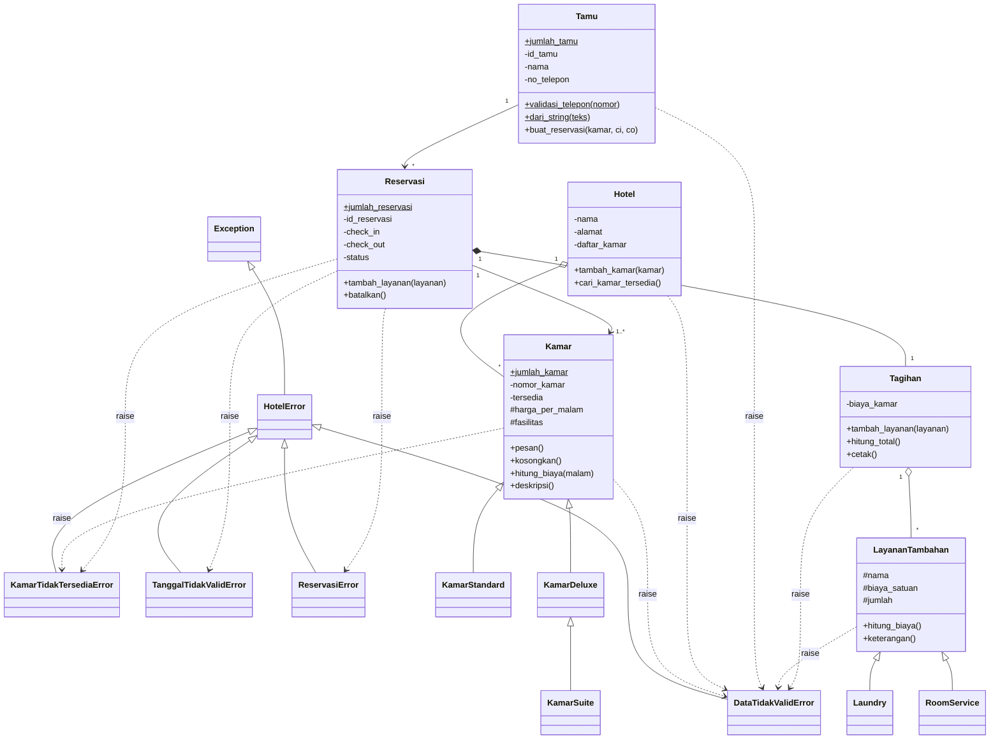

# Sistem Reservasi Hotel (dengan Exception Handling)

Pengembangan proyek UTS dengan menambahkan exception handling pada studi kasus reservasi hotel.

## Anggota Kelompok

| Nama                         | NIM        | Kontribusi                                |
| ---------------------------- | ---------- | ----------------------------------------- |
| Candra Made Lintang Rakaheni | 2501010011 | reservasi.py, main.py, README.md          |
| Azalea Vidya Kirana          | 2501010014 | exceptions.py, kamar.py, hotel.py         |
| I Made Dhananjaya            | 2501010033 | tamu.py, layanan_tambahan.py, tagihan.py  |

## Aturan Bisnis yang Dapat Dilanggar

| No  | Aturan                                                                                    | Exception               | Lokasi                          |
| --- | ----------------------------------------------------------------------------------------- | ----------------------- | ------------------------------- |
| 1   | Harga kamar, biaya satuan, dan jumlah layanan harus > 0; biaya kamar tidak boleh negatif  | DataTidakValidError     | Kamar, LayananTambahan, Tagihan |
| 2   | No telepon 10-13 digit angka, nama tidak kosong                                           | DataTidakValidError     | Tamu                            |
| 3   | Kamar yang dipesan harus tersedia                                                         | KamarTidakTersediaError | Kamar, Reservasi                |
| 4   | Check-out harus setelah check-in                                                          | TanggalTidakValidError  | Reservasi                       |
| 5   | Minimal 1 kamar; reservasi batal tidak bisa dibatalkan/ditambah layanan lagi              | ReservasiError          | Reservasi                       |
| 6   | Nomor kamar tidak boleh duplikat di hotel                                                 | DataTidakValidError     | Hotel                           |
| 7   | Kamar yang sama tidak boleh dipesan dua kali dalam satu reservasi                         | ReservasiError          | Reservasi                       |

## Hierarki Exception

`HotelError` adalah base exception (turunan `Exception`) dengan empat turunan:
`DataTidakValidError`, `KamarTidakTersediaError`, `TanggalTidakValidError`, dan `ReservasiError`.
Semua didefinisikan di `exceptions.py`.

## Class Diagram



## Penanganan Exception di Program Utama

`main.py` menggunakan blok `try`, `except` (dari yang spesifik ke umum), `else`, dan `finally`
untuk menguji setiap aturan bisnis di atas.

## Cara Menjalankan

```bash
python main.py
```